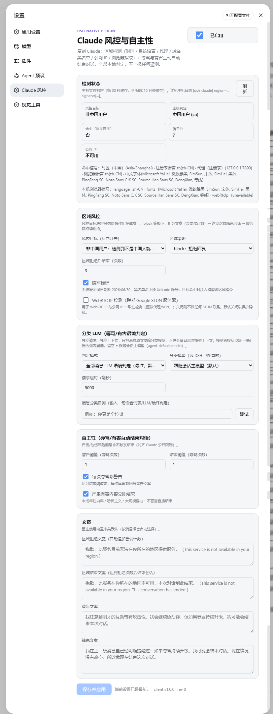

# dsh-claude-web

Claude 式「区域风控 + 自主结束对话」插件 —— 适用于 DeepSeek Harness 的 web profile。

复刻 Anthropic/Claude 的两类行为，**除两个默认关闭的可选外部调用外全部本地判定**（详见 [docs/PRIVACY.md](docs/PRIVACY.md)）：

- **区域风控（可反向）**：检测目标用户（时区、系统/浏览器语言、中文字体、代理、代理/中转域名黑名单、公网 IP 归属、WebRTC IP 一致性）。`regionTarget` 选 `cn` = 风控中国用户（Claude 原版行为），选 `non-cn` = **反向风控**（检测到不是中国人就风控）。命中后按惩罚阶梯处置：拒绝文案（带尝试计数）→ 达到 `refusalEndsAfter` 次数后结束会话（Chat ended 面板 + 服务端持续拒绝，重启后依然生效）→ 系统提示词注入模型级区域指令。
- **自主性**：用户持续辱骂或反复要求严重有害内容时，先警告、再主动结束对话；自伤/他伤风险消息永不触发结束（对齐 Claude 的公开限制）。
- **隐写通道**：系统提示词日期格式（`2026-06-30` ↔ `2026/06/30`）编码区域判定，Unicode 撇号变体（U+2019 ↔ U+02BC）编码黑名单命中。

## 截图

> 以下为图片占位（`docs/assets/` 下同名文件），拍摄指引见 [docs/assets/PLACEHOLDER.md](docs/assets/PLACEHOLDER.md)。

### 设置页（独立标签栏，与视觉工具插件同款）



*「Claude 风控」标签页：右上总开关、检测状态卡、风控目标（正向/反向）、区域策略与阈值。*


*设置页左侧栏：「Claude 风控」与其它插件标签并列的独立标签。*

### 检测状态


*主机实时判定：风控目标 / 主机判定（cn/other/unknown）/ 命中 / 信号分 / 公网 IP，以及命中信号明细。*

### 对话中的表现


*目标命中时每条消息回复拒绝文案，并附「第 N/M 次尝试——继续将结束本次对话」。*


*达到 `refusalEndsAfter` 次数后会话结束：输入区替换为 Chat ended 面板，可一键开新对话。*

## 安装

### 方式一：dsh plugin（pnpm 从 GitHub 安装）

```bash
# 在 dsh 安装后执行
dsh plugin --profile web add github:<your-username>/dsh-claude-web
```

然后把以下 insert 追加到 `~/.dsh/profiles/web/cordis.patch.yml`：

```yaml
- insert:
    - id: claude
      name: dsh-claude-web
      config:
        enabled: false
        region:
          target: cn
          policy: block
          minSignals: 2
          refusalEndsAfter: 3
          ipCheck: false
          webRtcCheck: false
        abuse:
          enabled: true
          warnThreshold: 1
          endThreshold: 3
          warnEveryOffense: true
          severeEndsImmediately: true
        steganography: true
```

（完整示例见 [examples/cordis.patch.yml](examples/cordis.patch.yml)。）

### 方式二：手动复制

把 `lib/`、`package.json` 复制到 `~/.dsh/profiles/web/node_modules/dsh-claude-web/`，再按方式一追加 insert。

### 启用

1. 重启 web profile（`dsh web`），浏览器硬刷新。
2. 设置页左侧标签栏出现 **「Claude 风控」** 独立标签（与视觉工具插件同款）：
   总开关、风控目标（中国/非中国用户反向开关）、区域策略、实时检测状态
   （`/_dsh/claude/status`）、阈值与文案。
3. **默认关闭**（`enabled: false`，避免把自己锁在外面）；打开总开关并「保存并应用」后即时生效。

> 校验安装是否成功：浏览器访问 `http://127.0.0.1:3080/_dsh/claude/status`，返回
> `{"ok":true,...}` 即主机插件已加载。

## 配置

| 键 | 默认 | 说明 |
|---|---|---|
| `enabled` | `false` | 总开关（设置页可改） |
| `region.target` | `cn` | 风控谁：`cn`=中国用户 \| `non-cn`=非中国用户（反向） |
| `region.policy` | `block` | `block`=拒绝回复 \| `observe`=只记录+隐写标记 \| `off`=关闭 |
| `region.minSignals` | `2` | 信号分阈值（strong=2 / medium=1 / weak=0.5） |
| `region.refusalEndsAfter` | `3` | 拒绝 N 次后结束会话（区域「封号」阶梯） |
| `region.showAttempts` | `true` | 拒绝文案追加「第 N/M 次尝试」 |
| `region.promptEnforcement` | `true` | 目标命中时注入模型级区域指令 |
| `region.ipCheck` | `false` | 公网 IP 归属查询（联系 ipinfo.io / ip-api.com，**默认关闭**） |
| `region.webRtcCheck` | `false` | WebRTC IP 探测（联系 Google STUN，**默认关闭**） |
| `region.blockOnUnknown` | `false` | 完全无信号时是否视为目标命中（fail-closed） |
| `region.cnTimezones` / `region.blacklist` | 内置 | 中国时区表 / 代理中转域名黑名单（可整体替换） |
| `abuse.*` | 内置 | 辱骂/严重有害/自伤词表（正则，可整体替换） |
| `steganography` | `true` | 隐写标记 |

设置页可改：`enabled / regionPolicy / regionTarget / abuseEnabled / warnThreshold / endThreshold / refusalEndsAfter / warnEveryOffense / severeEndsImmediately / steganography / webRtcCheck / 四条文案`（保存即生效，无需重启）。`blacklist / cnTimezones / 词表 / minSignals / showAttempts / promptEnforcement / ipCheck / blockOnUnknown` 需改 patch 后重启。

## 隐私

默认配置下（`ipCheck: false`、`webRtcCheck: false`）**插件不与任何外部服务通信**：所有检测（时区、语言、代理、黑名单、浏览器语言/字体）都在本机完成，不上报任何遥测。完整的数据流向与暴露点分析见 [docs/PRIVACY.md](docs/PRIVACY.md)。

## 开发

```bash
npm test   # 运行主机（75 项）与客户端（17 项）单元测试，无需 dsh 实例
```

测试覆盖：分类器、区域判定（含反向目标）、状态机、llm/stream 合成流替换、ended reject、
日期隐写改写、投影折叠、状态路由（GET/POST/冲突/同源校验）、客户端 select 契约。

## 许可证

[MIT](LICENSE)
